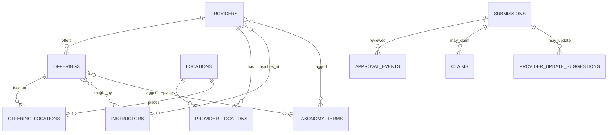

# Acting Education Directory — Phase 1 Audit

**Audit date:** 2026-11-05  
**Scope:** Read-only code/configuration audit and representative official-source scan. No production systems accessed; no files outside this report changed.

**Subsequent status:** The isolated application was deployed by explicit user approval to the independent `acting-class-directory` Worker and D1. The Headshot Scout resources identified during this audit were not used or modified.

## Executive summary

At the time of this audit, the repository was a functioning Headshot Scout copy, not an isolated acting directory. The audited copy had production Cloudflare, GitHub, analytics, advertising, email, domain and deployment configuration. Those values have since been removed; this report intentionally omits their identifiers. Do not use any prior external resource. The acting directory now uses only its independently provisioned resources documented in the current Wrangler configuration.

The most reusable pieces are React/Vite/Cloudflare Worker delivery, responsive listing UI patterns, URL/query and sorting utilities, SEO prerendering patterns, submission validation, secure one-use approval links, transactional D1 writes, email delivery status tracking, audit records, and duplicate handling. Existing photographer data, branding, taxonomies, submission records, routes, templates, and all account/resource configuration are not reusable as product data or infrastructure.

## 1. Codebase and infrastructure audit

| Area | Current state | Action for independent app |
|---|---|---|
| Frontend | React/Vite (`src/App.jsx`, `src/styles.css`); photographer-specific UI and vocabulary | Keep React/Vite patterns; replace product UI, taxonomy, forms, routes, copy, assets and colors |
| Data | Static photographer directory and branding (`src/data/photographers.js`, `photographer-branding.js`); worker publication reads that directory for duplicate detection | Do not copy listing records. Replace static import with acting directory seed records in a new schema; retain source URL and verification metadata |
| Worker/API | `src/worker.js` exposed photographer submission/listing/photo APIs and hard-coded original-brand paths | Rework as acting-specific providers, offerings, instructor relationships, submissions, claims, updates and public profile APIs |
| D1 | The audited `wrangler.jsonc` named the original submissions database and included its production ID | Create a brand-new D1 database and fresh migration history. Never apply the old migrations remotely; use only the independent acting-directory migration |
| Cloudflare | The audited config included the original account ID, Worker name and custom domains | The acting directory now has its own Worker and D1; a custom domain is still undecided |
| GitHub | `.git/config` pointed at the original repository and contained copied history | The old history was detached and a new repository is configured as the only remote |
| Email | Original recipient, domain, OAuth mailbox and Resend sender identifiers were embedded in source/config | New dedicated inbox/project and sender are required only if email is approved later. No email credentials are configured |
| Gmail polling | Approval/audit tables and Gmail OAuth helper exist, but no `scheduled()` Worker handler, Gmail polling implementation, or cron trigger is present in current source/config | Treat polling as not implemented in this copy. If desired, build it independently after deciding whether tokenized approve/reject email links already meet the admin need |
| SEO | The prerenderer, sitemap, metadata, canonical URLs and profile HTML were photographer-specific and included old tracking IDs | Reuse the rendering approach, replace all metadata/data/routes, use a new origin, and omit tracking until separately provisioned |
| Deployment | `.github/workflows/deploy-worker.yml` deployed using the old production URL and Cloudflare credentials | Disable/replace before any deployment from this repo. Configure new scoped GitHub secrets only for the new Cloudflare account/resources |
| Environment/secrets | No `.env` or `.dev.vars` files were listed at repository root; ignore rules allow local secret files. Their absence does not establish whether secrets exist in external accounts | Keep new local values in ignored `.dev.vars`; provide `.dev.vars.example` with names only. Never copy existing secret values |

Other copied dependencies identified by repository search included old domain defaults, brand copy, analytics/ad identifiers, tracking token and photographer SEO routes. These were removed with the old data, email, prerender and deployment code. The new app is noindex and has no external tracking tags.

### Reusable behavior

- React components and mobile layout patterns, after redesign.
- URL-based state, sorting and directory utility patterns.
- Vite + Cloudflare Worker static asset serving.
- Submission validation and non-blocking email failure handling.
- Single-use, hashed, expiring approval tokens with idempotent replay handling.
- D1 audit events and notification status/error tracking.
- Approved-only publication and generated profile/sitemap approaches.

### Must not reuse

- Any Headshot Scout listing/submission/portfolio image record or image storage.
- Existing database, migrations applied to remote, Worker, account, custom routes/domain, GitHub remote, email account/OAuth client, Resend sender/API key, analytics/ad/Cloudflare tracking IDs, or credentials.
- Original provider taxonomy, photographer forms, copy, logos, photos, or branding.

## 2. Independent resources and credentials required

Provision only after approval of resource names/origin:

1. New GitHub repository (independent commit history) and deployment secret scoped to the new Cloudflare account.
2. New Cloudflare Worker, D1 database, and optionally R2 bucket for listing imagery. D1 is sufficient for initial structured data; use external official image URLs initially or R2 only where usage rights and storage needs are clear.
3. New domain/subdomain, DNS route, and `SITE_URL`.
4. Dedicated directory inbox and a separately configured Google OAuth client only if Gmail polling/commands are chosen.
5. Resend account/domain verification and new `RESEND_API_KEY`/`RESEND_FROM` only if provider/administrator email is enabled.
6. New secrets for approval-link administration if retaining manual reissue. No secrets should be created or requested for this audit.

No resource has been created. No integration has been authorized or connected.

## 3. Proposed data model

Keep providers and offerings separate. A studio/school or independent coach is a provider; a class/workshop is an offering. Instructors are people with many-to-many associations to providers and offerings. A coach can also be a provider with a coach listing type, avoiding a duplicate parallel coach entity. Store prices as numeric amount plus currency, price basis and optional range; never infer course total vs session rate. Store each structured claim with a verification state and source URL/date. Keep missing values NULL, not false/zero.

Suggested tables: `providers`, `offerings`, `instructors`, `provider_instructors`, `offering_instructors`, `locations`, `provider_locations`, `offering_locations`, `taxonomy_terms`, `provider_terms`, `offering_terms`, `submissions`, `claims`, `provider_update_suggestions`, `approval_events`. Each listing needs `status` (draft/published/archived), `claim_status`, `origin` (seeded/submitted), slug, official website, Instagram, image URL, description, and timestamps. Add `source_url`, `verified_at`, and verification state to researched facts/listing fields. Offering pricing: `price_min`, `price_max`, `currency`, `price_basis` (per_session/hour/full_course/workshop/other), with NULL for unpublished prices. Location should hold city, state, borough/neighborhood, postal address and online flag; borough/city identity stays data-driven to permit LA later.

Submissions should be separate pending editorial records, not immediately public rows. Approval event records actor, action, time and notes. Claims and proposed updates do not grant editing rights or modify published fields until separately approved. Use indexes on publish status/type, slug, location, verified price, taxonomy joins and submission/claim status.

## 4. Proposed application architecture and workflow

- React/Vite provides homepage, searchable directory, type-specific profiles and public submission/claim forms.
- Cloudflare Worker serves the static frontend, read APIs, submission APIs and protected approval routes.
- New D1 is the source of truth. New seed data starts empty and is populated only after editorial review.
- Central taxonomy maps stored terms to display/filter categories. Only verified values are filterable.
- Initial review workflow should prefer the existing signed-link approach: save pending record first; send an admin email with one-use expiring approve/reject links; write decision/audit status; publish only approved data; send submitter notification. Email failures must not lose submissions.
- Gmail command polling is not currently present in this repository. Rebuilding it introduces Gmail OAuth, refresh-token custody, scheduled Worker triggers, message deduplication and command parsing. Given the already implemented approval links, a separate admin Gmail mailbox/polling integration should be deferred unless email reply commands are a must-have.
- Images: store only an official provider-supplied or clearly authorized image URL initially. Later add best-effort OG lookup with timeouts and manual override; keep failures non-blocking. Do not copy current photographer images or use their storage.
- SEO: static category/location pages only when enough published listings make them useful; profile pages only for published entries; sitemap excludes pending/rejected content.

## 5. Official-source sample and filter evidence

This is a representative discovery sample, not a census. I reviewed official provider/class information surfaced for The Acting Studio New York, Actors Bridge, Acting Gym NYC, JB Actors Studio, Manhattan Actor Studio, Stella Adler Studio, Upright Citizens Brigade NYC, and The Barrow Group, plus HB Studio. Availability changes by enrollment cycle; this scan did not verify every page directly or normalize all scheduled offerings, and search-indexed official content may be stale. It supports qualitative recommendations, not coverage percentages.

- The Acting Studio publishes named Meisner course levels, class duration, total tuition/monthly rates, intensive structures, private rates, and in-person/online options. [Official class page](https://www.actingstudio.com/acting-classes/meisner/) and [private coaching](https://www.actingstudio.com/acting-classes/actors/private-acting-coaching/).
- Actors Bridge publishes dated class schedules, time windows, technique levels and studio location; price visibility varies across pages. [Official schedule](https://actorsbridge.org/classschedule/).
- Acting Gym publishes online classes with dates, weekly schedules and fees, as well as coaching types and hourly rates. [Official classes](https://actinggym.nyc/classes/).
- JB Actors Studio publishes a private coaching intake path, online availability and specific fee/package information. [Official private coaching](https://www.jbactors.nyc/services-code/private-coaching).
- Manhattan Actor Studio publishes course descriptions, Meisner focus and coach/session pricing. [Official class prices](https://manhattanactorstudio.com/class-descriptions-and-prices/).
- Stella Adler’s official workshop pages publish NYC location, tuition, dates, format, experience level, application/interview requirements; a drop-in page explicitly states no interview/application for that offering. [Drop-in](https://classes.stellaadler.com/workshops/drop-in-class-tech-fundamentals/) and [Evening Introductory Program](https://classes.stellaadler.com/workshops/eip/).
- UCB’s official listing exposes price, start date, instructor, venue, online vs in-person location, level/program and weekly/intensive frequency on individual course entries. [Improv program and class listings](https://ucbcomedy.com/training-center/improv-program/).
- Barrow Group maintains current class listings and separate audition requirements for selected professional classes; requirements are class-specific. [Adult classes](https://www.barrowgroup.org/acting-school/classes/) and [training program audition details](https://www.barrowgroup.org/acting-school/resources/training-program-audition/).
- HB Studio’s official pages present a structured curriculum across acting, scene study, movement, voice and speech, while tuition may appear on program-specific pages rather than a uniform per-class format. [Hagen Core](https://www.hbstudio.org/hagen-institute/the-hagen-core/).

## 6. Filter recommendations

Fundamental filters from the brief remain the launch baseline: verified budget with explicit price basis/currency, borough/online location, listing type, practical training type, supported acting technique, and verified format. Search can match provider/class/coach/technique text. Missing data remains unknown and never excludes a listing by default.

| Candidate characteristic | Evidence in sample | Reliability / actor value | Recommendation |
|---|---|---|---|
| Format (in-person/online/hybrid) | Explicitly stated by Acting Studio, Acting Gym, JBAS, UCB, Stella Adler and event/class pages | High when attached to a specific offering; high practical value | Fundamental filter |
| Skill level / program level | Explicit beginner/all-level labels at Stella Adler; sequential levels at UCB and Meisner studios; advanced/professional classes at Barrow | Medium-high but labels differ and some are prerequisites/program stages | Secondary filter after listings encode a controlled beginner/intermediate/advanced/all-level/experience-required value; retain raw wording |
| Schedule/day/time/frequency | Detailed on UCB and Actors Bridge; class-specific dates/times on Acting Gym/Stella Adler | Strong for scheduled cohorts but volatile and not consistent for ongoing classes | Profile information first; later add schedule facets only for active dated cohorts, with expiry/update handling |
| Duration/session count | Clearly stated for programs at Acting Studio/Stella Adler and UCB cohort listings; uneven elsewhere | Medium-high where published; useful for commitment comparison | Store/display as offering details; consider secondary duration/session-count filters once seed sample coverage is measured |
| Audition/interview/application required | Explicit on Stella Adler program pages and Barrow professional classes; varies by class | Reliable per offering, but not common or universal | Store/display verified requirement; secondary filter only if enough published listings in actual seed set |
| Group vs private | Private coaching explicitly listed by Acting Studio, Acting Gym, JBAS and Manhattan Actor Studio; standard classes are clearly cohort/group | High, useful distinction across listing types | Store `instruction_mode`; likely secondary filter, but separate coach listings already cover much discovery. Reassess after seed entry |
| Genre/specialty (comedy, classical, musical theatre, etc.) | UCB strongly exposes comedy/improv/sketch; others expose theatre/film/TV focus | Useful but highly heterogeneous and often descriptive | Store as profile taxonomy/tags; don't make one global filter until controlled vocabulary and coverage justify it |
| Technique | Meisner, Stella Adler, and Hagen curricula explicitly represented by providers | Reliable only on sources that name it; relevant | Fundamental filter with controlled list plus Other; do not infer from school reputation |

Recommendation: keep the directory interface to fundamental filters at launch. Preserve the fields above in the data model and profiles. After entering a reviewed seed sample, calculate actual field coverage and decide whether skill level, instruction mode, duration or requirements deserve secondary controls. Do not claim quantified source coverage from this discovery scan.

## 7. Fields to retain even when not filters

Retain description/teaching approach, raw and normalized training specialties, instructor associations, genre focus, published schedule and active dates, duration/session count, skill language, audition/interview/application process, enrollment status, location/address and accessibility notes if published, pricing wording and structured equivalent, registration/contact URLs, source URL, last verified date, image provenance, verification status, and applicable age range. Unknown/unverified/not-provided must be distinct. Profiles can display useful verified details even when those details are not filter controls.

## 8. Phases, risk and next approval gate

1. **Isolation:** create new brand/domain/repo/resource plan; replace/remove inherited production bindings; define new empty D1.
2. **Data/backend:** implement new schema, migrations and Worker APIs against local D1, then new resources after approval.
3. **Research:** establish source/verification editorial format; research and review seed listings; measure field coverage before expanding filters.
4. **Frontend:** establish brand/design system; homepage, directory, profiles and only approved filters.
5. **Submissions/admin:** provider submissions, claims, suggested edits and approval links; add Gmail polling only if specifically selected.
6. **Images/SEO:** safe image lookup/manual override, prerender/profile metadata, sitemap and robots.
7. **Verification/deployment:** test approved flows, inspect isolation references and produce a final isolation report; deploy only after approval of named infrastructure.

Primary ongoing risks are stale provider schedule/pricing; ambiguous total-vs-per-session prices; insufficient coverage behind expanded filters; and image copyright/availability. The new Worker uses an admin secret stored outside Git. The project cannot prove whether unrelated external resources or credentials exist in the account.
